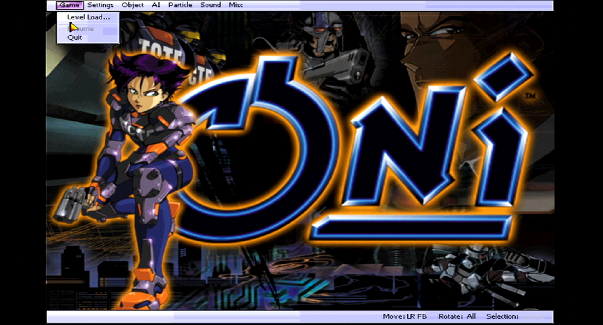
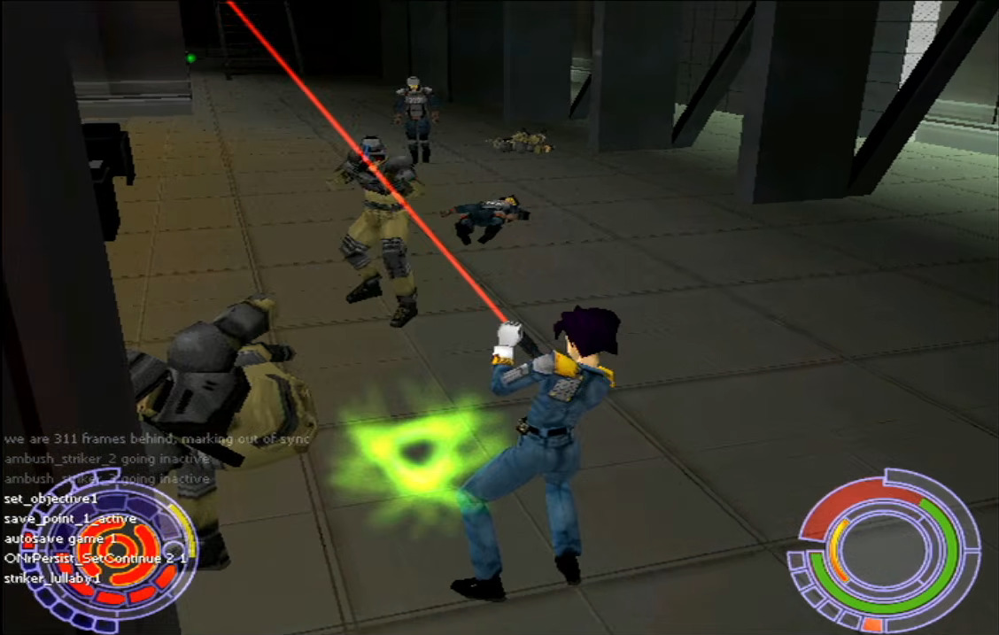
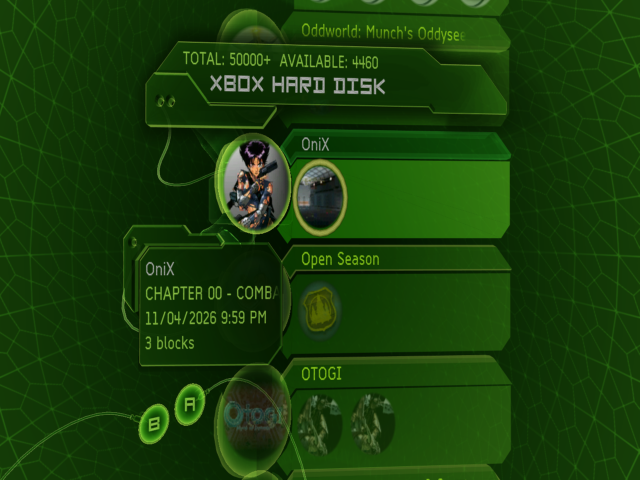

# MotokoX

  <em>Oni for the original Xbox using OniFoxed and NXDK.</em> 
   
   
   
<i>Save data from OniFoXed, as viewed in the dashboard.</i> 

# Working:
- [x] Launching the game
- [x] Reaching the main menu
- [x] Gameplay
- [x] Audio
- [x] Software rendering
- [x] Dual input methods (keyboard + mouse as well as controller)
- [x] 64MB support
- [x] Basic SDL3 support

# Partially working:
- [x] Controls (fully playable, controller is essentially mapped to real keys, making the game feel more like a PC port than it's PS2 counterpart. Prompts also still currently display their keyboard binding names instead of controller button names or icons)

# Not working:
- [ ] Hardware rendering
- [ ] Xemu support
- [ ] Saving

# Planned:
- [ ] Native save integration that includes per-chapter save icons
- [ ] Xbox button prompts + more controller-friendly UI options
- [ ] Demo(?)
- [ ] XISO/HDD/CD/DVD support (see save integration)
- [ ] Auto resolution detection to run the game in 480p or 720p, if performance allows.

# Not Planned:
- [ ] AE support or anything outside of a 1:1 port of the original game, as the port should feel like a native console release.

# Untested:
- [ ] Gameplay (I only own a stock 64MB Xbox which unfortunately OOMs on level change, and none of the builds that display more than general log info have successfully rendered a menu in Xemu)

# Installation
- Download and extract the latest release .zip file to your folder of choice
- Copy your "GameDataFolder" folder from your Mac version or Windows demo version (1.1) of Oni beside "default.xbe". Game data is not provided with this port, nor will it ever be, but demo data may be provided at some point.
- To copy/delete your save data, you can manage it from the Xbox dashboard like any retail Xbox game.

# Building (NXDK)

- TBA

# Credits

Original README below.

# OniFoxed

## What's this?

This is a modified variant of the recently
leaked [Oni source code](https://archive.org/details/oni-source) so that it compiles
under Microsoft Visual Studio 2019 with some
minor fixes/changes.

The code is aligned to be run against the [Windows
demo version](https://archive.org/details/OniDemo) of the game, and because of this there are quite a few
issues when running this against the final retail
version of the game.

## What are you trying to accomplish?

Well, I wanted to get it compiling and running; I've
accomplished this.

Looking into the future I'd love to see the following,
but time is an issue for me - contributions are welcome!

- [ ] Migrate the projects to CMake
- [ ] Fix alignment issues against the final PC release
- [ ] Linux and macOS support
- [ ] Modernized renderer, with support for shaders
- [ ] 64-bit compatibility
